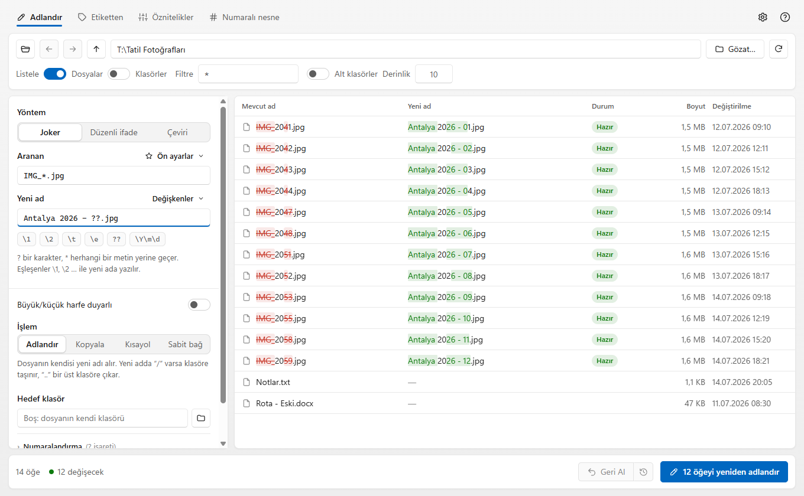
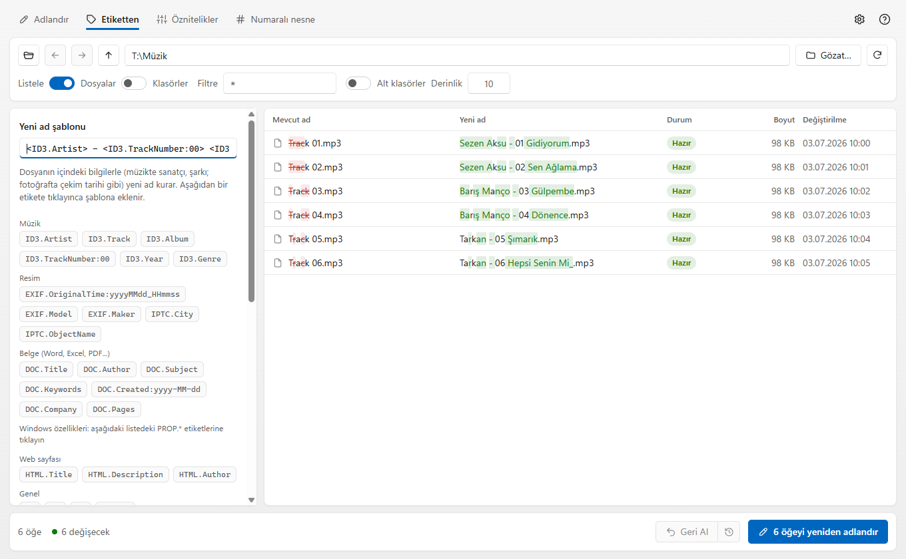
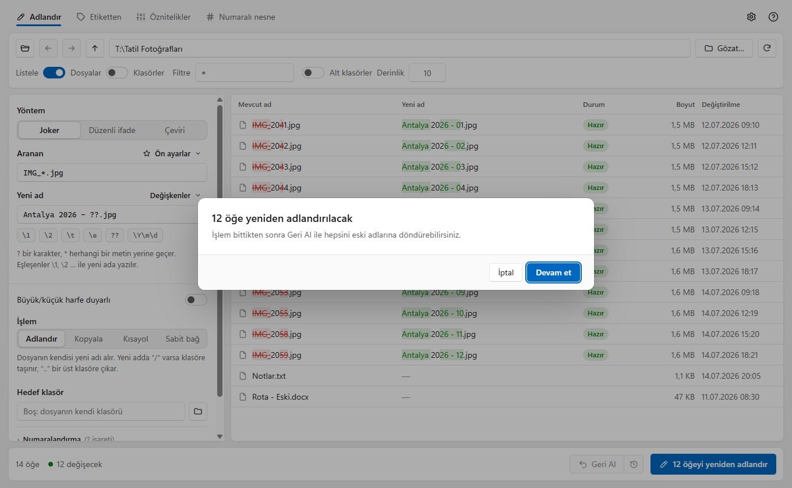
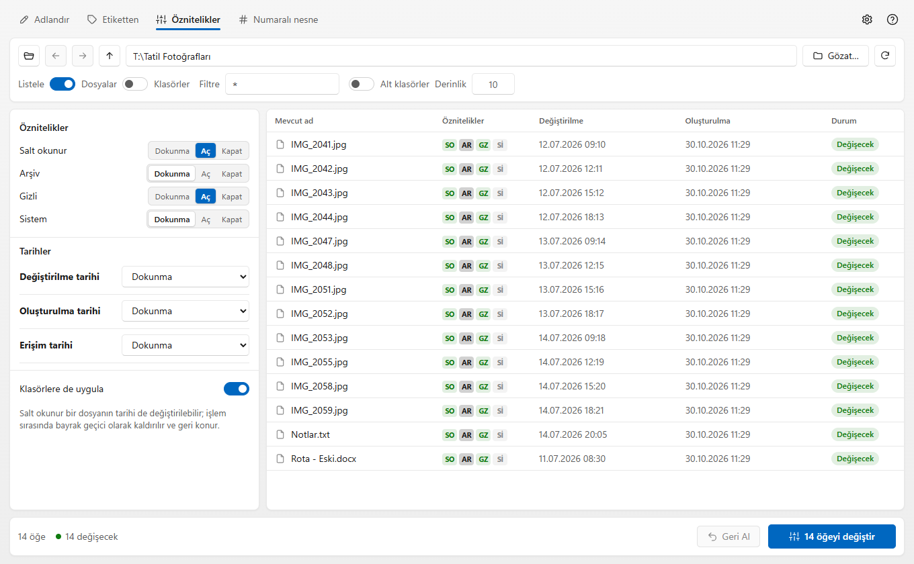

<div align="center">


# Dosya Terzisi

**Dosya ve klasör adlarını toplu olarak, önce önizleyerek, geri alınabilir biçimde değiştiren Windows uygulaması.**

[](https://github.com/MustafaKemal0146/DosyaTerzisi/actions/workflows/build.yml)
[](https://github.com/MustafaKemal0146/DosyaTerzisi/releases/latest)
[](https://github.com/MustafaKemal0146/DosyaTerzisi/releases)
[](LICENSE)


[**⬇ İndir**](https://github.com/MustafaKemal0146/DosyaTerzisi/releases/latest) ·
[Kullanım kılavuzu](docs/KULLANIM.md) ·
[Özellikler](#özellikler) ·
[Kaynaktan derleme](#kaynaktan-derleme)

<br />

<picture>
  <source media="(prefers-color-scheme: dark)" srcset="docs/images/adlandir-koyu.png" />
  
</picture>

</div>

---

## Neden Dosya Terzisi?

Tatil fotoğraflarının adı `IMG_2041.jpg`, müziklerin adı `Track 03.mp3`, belgelerin adı `rapor - Kopya (2).docx`.
Bunları tek tek düzeltmek saatler alır; yanlış bir toplu işlem ise dosyaları geri dönüşsüz bozar.

Dosya Terzisi bu işi **güvenli** yapar:

- **Önce önizleme.** Yeni adlar siz yazdıkça listede görünür; neyin değişeceği, neyin çakışacağı açıktır.
- **Siz onaylamadan hiçbir şey değişmez.** Onay penceresi çıkar, sonra uygulanır.
- **Hiçbir dosyanın üzerine yazılmaz.** Aynı ada denk gelenler "çakışma" diye işaretlenir ve atlanır; isterseniz otomatik numara eklenir.
- **Her işlem geri alınır**, program kapatılsa bile. Elektrik gitse yarım kalan işlem bir sonraki açılışta onarılır.
- **İnternet gerekmez, hesap yok, veri toplanmaz.** Her şey bilgisayarınızda çalışır.

## Özellikler

### Adlandırma yöntemleri
| | |
|---|---|
| **Joker** | `*` ve `?` ile basit kalıplar: `IMG_*.jpg` → `Antalya - ??.jpg`. Eşleşen parçalar `\1`, `\2` ile yeni ada taşınır. |
| **Düzenli ifade** | Tam güçte regex; `\u \U \l \L \E` ile büyük/küçük harf dönüşümü. |
| **Çeviri** | Karakter karakter değiştirme: `a-z` → `A-Z`, `çğıöşü` → `cgiosu`, boşluk → `_`. |
| **Etiketten adlandırma** | Dosyanın içindeki bilgiyle ad kurar: `<ID3.Artist> - <ID3.Track>.\e`, `<EXIF.OriginalTime:yyyyMMdd_HHmmss>`, `<DOC.Title>`. |
| **Betik** | İleri düzey: yeni adı VBScript/JScript ifadesiyle hesaplayın, kendi işlevlerinizi tanımlayın. |

### Değişkenler
Dosya adı, uzantı, klasör adı, üst klasör, tam yol, boyut, tarih ve saat (`\Y\m\d \H\M\S`, gün/ay adları, yılın günü…),
`%Y-%m-%d` biçiminde strftime, sıra numarası (`??` = 2 basamak; onluk, onaltılık ya da harf biçimi), rastgele sayı,
8.3 kısa ad. Hepsi **Değişkenler** menüsünden tek tıkla eklenir.

### Etiketler
- **Müzik:** ID3 (sanatçı, şarkı, albüm, parça no, yıl, tür…)
- **Fotoğraf:** EXIF ve IPTC (çekim tarihi, makine modeli, şehir, başlık…)
- **Belgeler:** Word, Excel, PowerPoint (yeni ve eski biçimler), OpenDocument ve PDF özet bilgileri (`DOC.*`)
- **Web sayfaları:** `<title>`, açıklama, yazar (`HTML.*`)
- **Windows özellikleri:** kabuğun gösterdiği tüm dosya özellikleri (`PROP.*`)

<picture>
  <source media="(prefers-color-scheme: dark)" srcset="docs/images/etiketten-koyu.png" />
  
</picture>

### Yalnızca ad değil
- **Kopyala, kısayol ya da sabit bağ oluştur:** dosyanın kendisini değil, yeni bir kopyasını adlandırın.
- **Klasöre taşı / dağıt:** yeni adda `Klasör/ad` yazın; klasörler gerekirse oluşturulur. `..` bir üst klasördür.
- **Öznitelikler ve tarihler:** salt okunur, arşiv, gizli, sistem; oluşturma/değiştirme/erişim tarihleri (sabit değer, kaydırma, başka bir tarihten alma, fotoğrafın çekim tarihi, rastgele).
- **Numaralı nesneler:** numaralı boş dosya/klasör ya da bir dosyanın numaralı kopyalarını üretin.

### Numaralandırma
Başlangıç ve adım, her klasörde yeniden başlama, tarihe ya da etikete göre sıfırlama (örneğin her albümde 1'den başla),
gruplara ayrılmış liste.

### Rahat bir arayüz
- Windows 11 havasında, sakin tasarım. **Açık ve koyu tema**; sistemin temasını izler.
- **Gezinme:** klasör ağacı, geri/ileri/üst klasör düğmeleri, listede çift tıkla klasöre gir, dosya ve klasörleri pencereye sürükle-bırak.
- **Satır satır düzeltme:** `F2` ile tek bir dosyanın adını elle yazın; `Delete` ile satırı listeden çıkarın.
- **Sütunlar ve gruplar:** liste başlığına sağ tıklayıp etiketleri sütun yapın, dosyaları etikete göre gruplayın.
- **Favoriler ve hazır ayarlar:** sık kullandığınız kuralları kaydedin; içe/dışa aktarın.
- **İlk açılışta kısa tanıtım turu.** Yazı tipi, boyut ve çubukları ayarlardan değiştirebilirsiniz.
- **Büyük klasörler:** 20 bin dosyalı klasörde listeleme ve önizleme yarım saniye civarındadır; liste sanallaştırılmıştır.

### Windows ile bütünleşme
Ayarlardan açılır (yönetici izni gerekmez, yalnızca sizin hesabınız):

- Klasöre sağ tık → **Dosya Terzisi ile yeniden adlandır**
- Dosyalara sağ tık → **Gönder → Dosya Terzisi**

<table>
  <tr>
    <td width="50%">
      
      <br /><sub><b>Onay.</b> Hiçbir şey sormadan değişmez; sonra Geri Al ile döner.</sub>
    </td>
    <td width="50%">
      
      <br /><sub><b>Öznitelikler ve tarihler.</b> Toplu olarak, önizlemeli.</sub>
    </td>
  </tr>
</table>

## Kurulum

1. [**Son sürümü indirin**](https://github.com/MustafaKemal0146/DosyaTerzisi/releases/latest) (`DosyaTerzisi-x.y.z.zip`).
2. Zip'i bir klasöre çıkarın.
3. `DosyaTerzisi.exe` dosyasını çalıştırın. Kurulum gerekmez; .NET de kurmanız gerekmez.

**Gereksinimler:** Windows 10 ya da 11 ve Microsoft Edge WebView2 (Windows 11'de hazır gelir; eksikse program indirme sayfasını önerir).

> Windows SmartScreen "bilinmeyen yayımcı" uyarısı gösterebilir; uygulama imzasızdır. **Ek bilgi → Yine de çalıştır** deyin.
> Bütünlüğü doğrulamak isterseniz her sürümle birlikte SHA-256 özeti yayımlanır.

## Kaynaktan derleme

Gerekenler: [.NET 8 SDK](https://dotnet.microsoft.com/download/dotnet/8.0) ve [Node.js 20+](https://nodejs.org/).

```powershell
git clone https://github.com/MustafaKemal0146/DosyaTerzisi.git
cd DosyaTerzisi

# Tek dosyalık yayın + zip paketi (release\ klasörüne)
powershell -ExecutionPolicy Bypass -File tools\publish.ps1
```

Geliştirme:

```powershell
dotnet test DosyaTerzisi.sln                      # çekirdek ve köprü testleri
cd web; npm ci; npm test; npm run typecheck       # arayüz testleri
node tools/e2e/shell-smoke.mjs release\DosyaTerzisi\DosyaTerzisi.exe   # gerçek uygulamayı ekran dışında sürer
node tools/screenshots/capture.mjs                # bu sayfadaki görüntüleri yeniden üretir
```

## Nasıl çalışır?

```
web/ (Next.js, statik)  ⇄  JSON mesajları  ⇄  Köprü  →  Oturum  →  Çekirdek
        arayüz                WebView2              C# / .NET 8        dosya işleri
```

| Klasör | Ne var |
|---|---|
| `src/DosyaTerzisi.Core` | Arayüzsüz çekirdek: planlama, çakışma çözümü, yürütme, geri alma günlüğü, etiket okuyucular, betik motoru |
| `src/DosyaTerzisi.Bridge` | Arayüzle konuşan katman: sözleşme tipleri, doğrulama, TypeScript tip üreticisi |
| `src/DosyaTerzisi.Shell` | WPF + WebView2 kabuğu; arayüz exe'nin içine gömülür |
| `web/` | Arayüz (Next.js, React, TypeScript) |
| `contract/fixtures` | Her iki tarafın da okuduğu örnek mesajlar; sözleşme tek kaynaktan üretilir |
| `tests/` | xUnit testleri (470'ten fazla); ayrıca arayüz testleri ve gerçek exe ile uçtan uca denemeler |

Güvenlik: arayüz yalnızca exe'nin içindeki dosyalara bağlı sanal bir adresten yüklenir; dış sitelere gidemez, yeni pencere
açamaz, izin isteyemez.

## Katkı

Hata bildirimleri ve öneriler için [Issues](https://github.com/MustafaKemal0146/DosyaTerzisi/issues) bölümünü kullanın.
Değişiklik önermeden önce `dotnet test` ve `npm test` komutlarının geçtiğinden emin olun.

## Lisans

[MIT](LICENSE) © 2026 Mustafa Kemal Çıngıl
